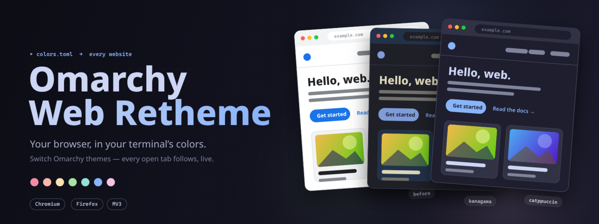

<p align="center"></p>

# omarchy-web-retheme

Browser extension (Chromium and Firefox) that restyles every website with your current [Omarchy](https://omarchy.org) theme. Switch themes and every open tab follows, live.

- `host/omarchy-web-retheme-host`: native messaging host. Reads `~/.local/state/omarchy/current/theme/colors.toml` and pushes it to the extension on connect and whenever the theme changes.
- `extension/`: MV3 extension. `css.js` turns the palette into CSS variables (`--omarchy-*`, `--owr-*`) plus override rules; `content.js` injects it at `document_start`.

## Install

```
./install.sh        # registers the native host for chromium / chrome / brave / firefox
```

**Chromium / Chrome / Brave:** `chrome://extensions` -> Developer mode -> Load unpacked -> `extension/`.
The extension ID is pinned by `key` in the manifest, so the host's `allowed_origins` stays valid.

**Firefox:** `about:debugging#/runtime/this-firefox` -> Load Temporary Add-on -> `extension/manifest.json`.
The same manifest serves both browsers (`service_worker` for Chromium, `scripts` for Firefox). The add-on ID
lives in `browser_specific_settings.gecko.id` and the host whitelists it via `allowed_extensions`.
Firefox MV3 makes site access opt-in: open the popup and click **Grant access to all sites** once.
Temporary add-ons vanish on restart; for a permanent install use Firefox Developer Edition / Nightly /
ESR with `xpinstall.signatures.required=false`, or sign it with `web-ext sign`.

## Modes

- **Full reset**: recolors every element that has an opaque background to the palette (page, surface, border shades), leaves transparent overlays, images and brand colors alone, and drops light gradient scrims.
- **Soft**: page background, text color, links, and form controls only.

## Known limits

- Shadow DOM contents aren't reached by page CSS.
- Sites that paint with `<canvas>` or inline SVG fills keep their own colors.
- Full mode will break the occasional site that signals state by background color only. Use the popup's per-site skip.

## Per-site tweaks

Big sites need nudging. `OWR_SITES` in `extension/css.js` holds per-site `skip` selectors (leave the site's own colors alone, e.g. video players) and extra `css`. X and YouTube are in there as examples: both draw touch targets as filled boxes, so their icon buttons are made transparent.

## Development

`docs/header.html` renders the header image on a canvas; open it in a browser or screenshot the `#c` element at 2x.

## License

MIT
